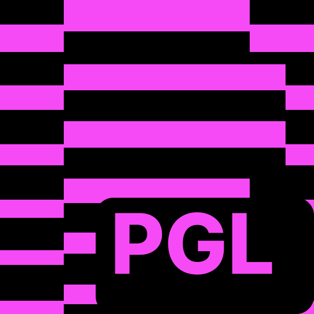

<p align="center">
  <br>
  <b>PGL-RUDesk</b><br>
  Удалённый доступ к компьютерам и телефонам через собственный сервер
</p>

## Возможности

- Управление компьютером и телефоном на расстоянии: экран, мышь, клавиатура, буфер обмена
- Передача файлов в обе стороны
- Сквозное шифрование соединения
- Свой сервер подключений — данные не проходят через чужие сервисы
- Прямое подключение по IP в локальной сети, без сервера
- Тёмная тема по умолчанию

## Платформы

| Система | Файл установки |
|---|---|
| Windows | `.exe` / `.msi` |
| Android | `.apk` |
| Linux | `.deb` / `.rpm` |
| macOS | `.dmg` |

Готовые установщики — в разделе **Releases**, тег `pgl-rudesk`.

## Сервер

Клиент уже настроен на сервер PGL-RUDesk, после установки ничего вписывать не нужно.
При переезде на другой сервер адрес и ключ меняются в настройках: **Настройки → Сеть → ID/Relay сервер**.

## Сборка

Вкладка **Actions** → **PGL-RUDesk Build** → **Run workflow**. Сборка всех платформ занимает 1–2 часа.

Все изменения внешнего вида (название, иконки, цвета, окно «О программе») собраны в папке `pgl/`.
После обновления исходного кода их можно применить заново:

```bash
python3 pgl/pgl-rebrand.py
```

## Автор

**SMV** — [4007079@gmail.com](mailto:4007079@gmail.com)

## Лицензия

Распространяется под лицензией **GNU AGPL-3.0** (файл `LICENCE`).
Основан на открытом проекте RustDesk © Purslane Tech Pte. Ltd.
